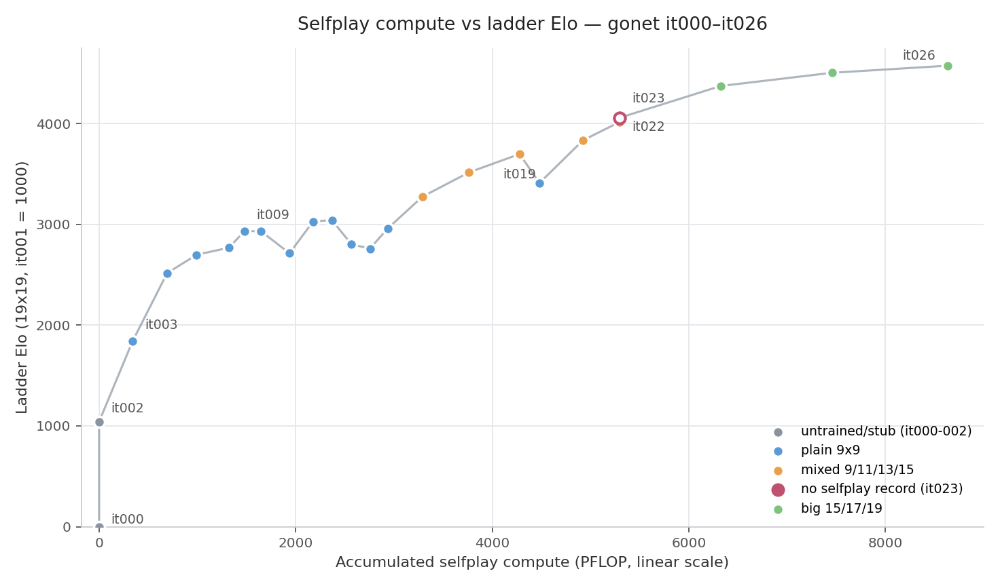

# A self-play Go AI

An AlphaZero-style go engine that improves by playing against itself.
The engine is built around a small 8-layer transformer neural network
(~6.7M parameters). The engine is trying to be simple to understand
and fast to train and yet deliver reasonable performance. You can try
a trained network checkpoint in the
[web](https://slcz.github.io/alaphazero-style-go/web/).

Like Alpha zero, the network has a value head that outputs a board
value and policy head that outputs the probability distribution over
moves. The engine improves by playing games against itself, using Monte
Carlo tree search guided by the value and policy heads and trains the
network on improved policy/value.

The engine is designed to be resource-efficient. Starting from a randomly
initialized network, it reaches intermediate to advanced player
(1k-1d rank) on a single consumer-grade GPU (RTX5090, 32GB VRAM) and a low end
AMD server with 32GB memory in 60 hours of continuous self-play, training
and evaluation loop (or ~$40 cloud compute cost).



*Scaling of the run: accumulated self-play compute per iteration
against a chained Elo ladder. Per-match records live in
[`checkpoints/matches/`](https://huggingface.co/chriszhang01/gonet/tree/main/checkpoints/matches)
on the model repo.*

## Efficient Selfplay and Training

To keep self-play economical, the engine uses the playout cap
randomization idea (David J. Wu, KataGo). Given a fixed compute budget,
it generates more games by running a full search on only a small number
of plies, searching most others with a smaller budget, and training the
network only on the fully searched plies. The network is trained on the
25% of plies that receive 200 simulations each; the remaining fast plies
use 40 simulations. Average per ply budget is 80 simulations, a puny
number compared with Alphago's 1600 simulations per step.

Instead of AlphaZero's PUCT selection rule, the engine's MCTS search uses
**regularized policy optimization** (Grill et al., 2020): PUCT's
hand-crafted formula approximates the solution to a regularized
policy-optimization objective. Here, $\bar{\pi}$ is computed as the solution
to,

$$
\bar{\pi} = \arg\max_y \left[ q^T y - \lambda_N \,\mathrm{KL}(\pi_\theta, y) \right].
$$

The same $\bar{\pi}$ is the policy-head training target, the distribution
sampled during MCTS descent, and the played move. This has a useful
property: there is no Dirichlet noise, no temperature, no visit-count
target, no hand-crafted exploration tricks and much less hyper-parameters to tune.
Because $\bar{\pi}$ is computeddirectly from Q-values, it also works well with
play-out cap randomization and the fast plies that use a small search budget. 
AlphaZero instead uses visit counts to estimate Q-values, which requires large
number of simulations to approximate $\bar{\pi}$.


Also borrowed from KataGo idea, the network has a few extra auxiliary training
head. Notably the ownership territory map and score difference.
Terminal state is scored and labeled using Tromp-tylor rules. This implies
that the selfplay has to up capture the dead stones before passes.
To train the engine to pass clean and to provide an accurate end of game
ownership and scoring lables for the loss heads, the MCTS utility function
has both the win/loss and score terms,

$$
utility = \lambda \cdot WL + (1 - \lambda) \cdot score
$$

During selfplay, $\lambda$ is set to 0.8. For matching, $\lambda$ is set to 1.0 to
maximize the win rate.

The network architecture is a 8 layer, 8 heads, 256 dimensions encoder-only transformer.
2D Rope is used to account for 2D board geometry. Transformer helps understand
global structures, such as ladder. In addition, a 3x3 convolution layer is
appended after the upscaling MLP to help understand local structure. Input features are
selected to reflect the geometry structure of the board, without any domain knowledge of
the game play. Muon optimizer is used across the network with learning rate set to 0.01
throughout. The network purposely supports different board size for mixed board size training
and evaluation.

Initial iterations are played on 9x9 board. Once a basic value/score head
is trained, larger board sizes are gradually introduced. Knowledge trained on smaller
boards transferred well into larger boards, saving computing resource. Without any
previous training on 19x19 board, the engine is able to compete at 6k level. At merely
15,000 19x19 sized game play and training, the network is able to compete at 1d level
(at 2000-4000 search budget).

## Build and test

To set up the environment and build the C binaries:

```sh
make -C engine all
make -C engine nn       # GTP + engine_mux (needs Python headers)
make -C engine check

python -m pytest tests/ -q
```

To run the self-play → training → evaluation loop:

```sh
python scripts/selfplay_loop.py --work-dir /data/go-run \
    --sizes 7:30000 --iterations 20 --device cuda --init-ckpt best.pt
```

The selfplay/training loop runs for 20 iterations. Each itertaion, 30,000
slefplay games are generated at 7x7 board.
`--init-ckpt` is optional: if it is omitted and `best.pt` does not exist,
the loop creates a random-init checkpoint in the work directory. On
macOS, use `--device mps`.

To run 100 matches (50 black, 50 white for each checkpoint), in batch
mode between 2 checkpoints,
```sh
python scripts/batch_match.sh --ckpt-a a.pt --ckpt-b b.pt --games 50 \
    --b 19 --device cuda
```

The engine support GTP protocol. It can connect to any GTP compatible interface
(e.g. Sabaki) to match agains human player or another bot. Check scripts/gtp.sh
for configuration details.
